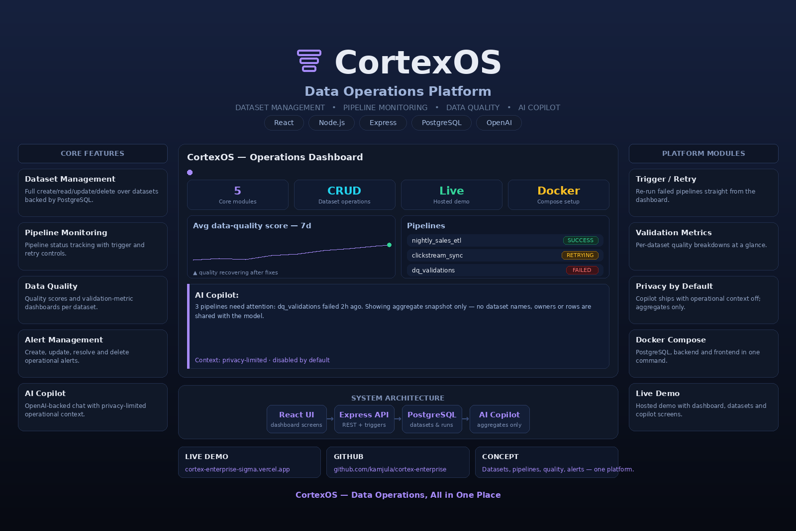
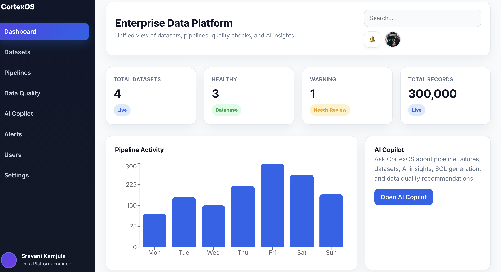
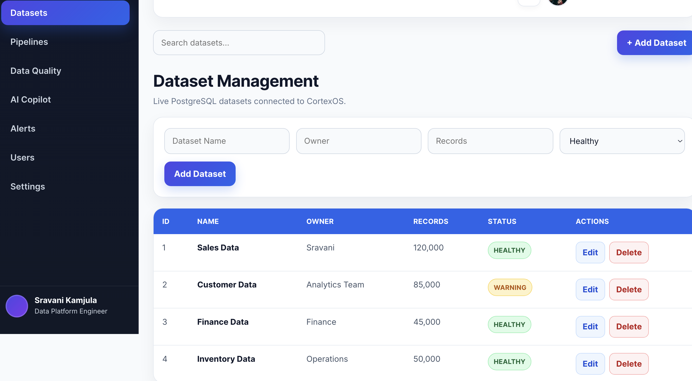
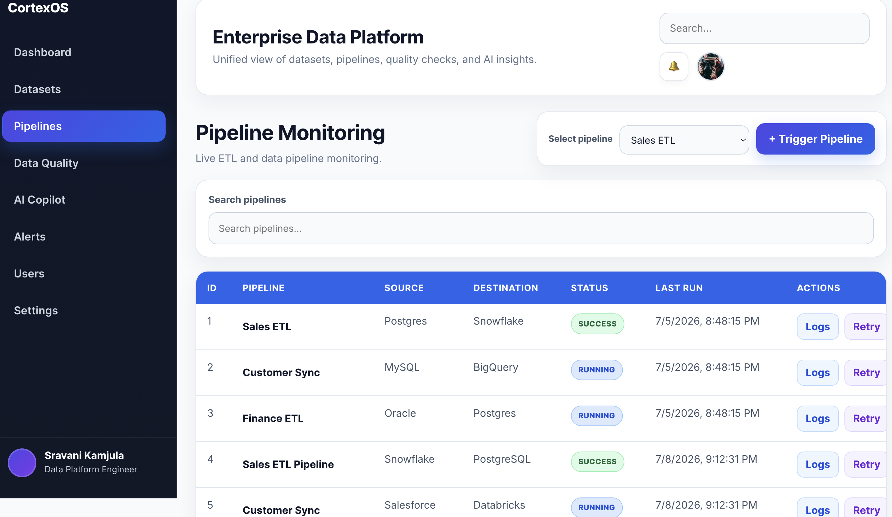
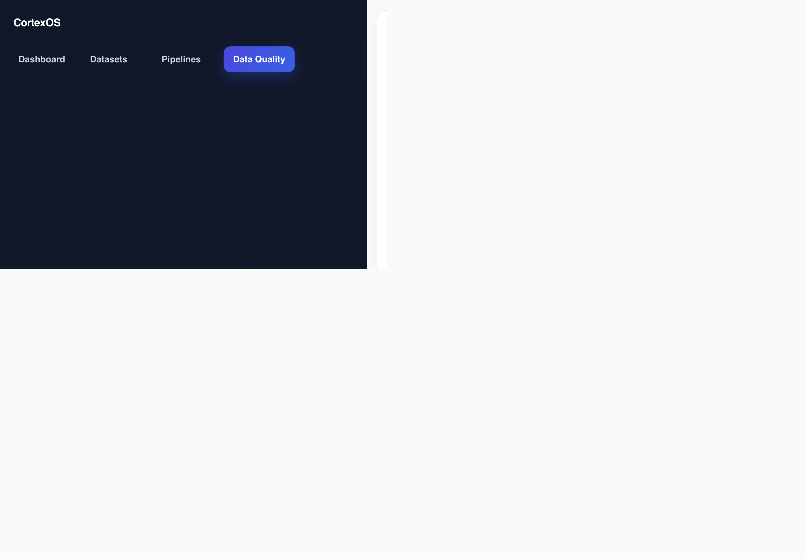
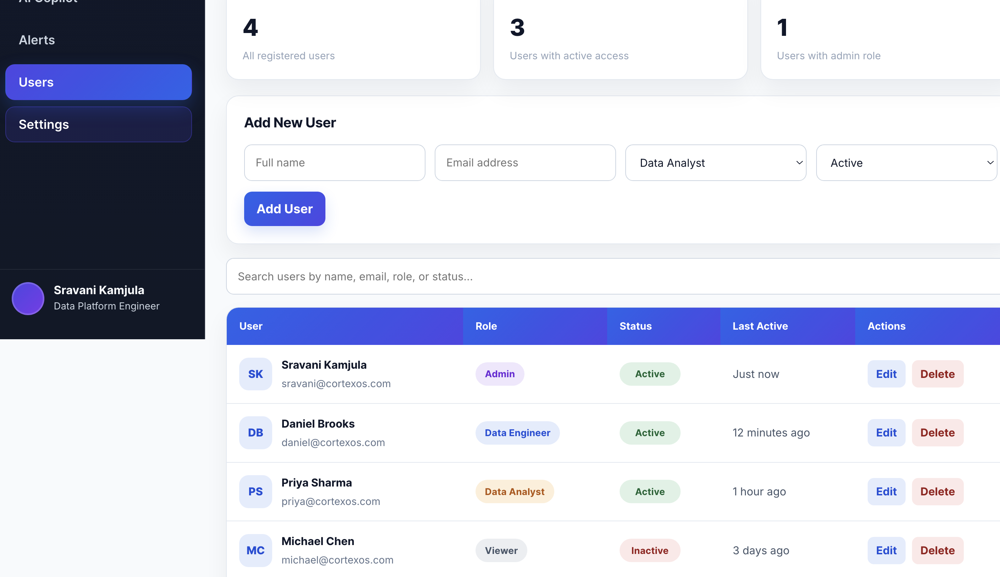
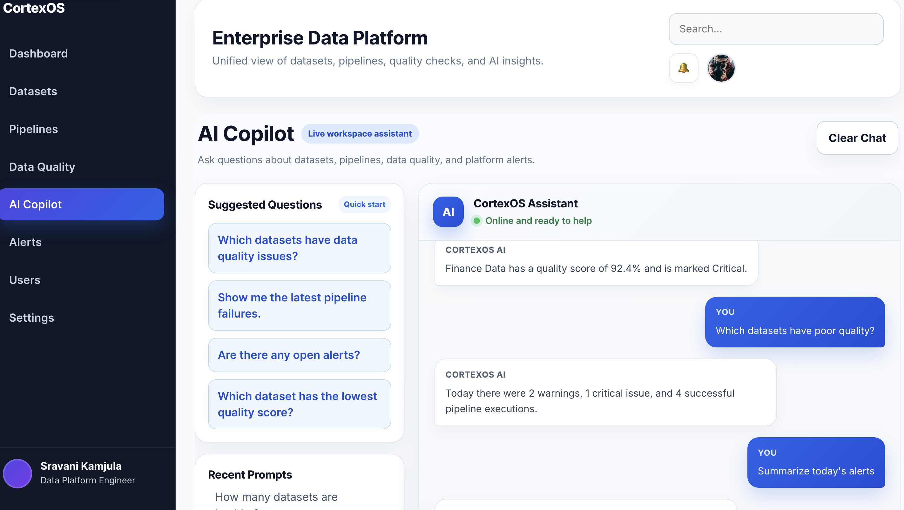
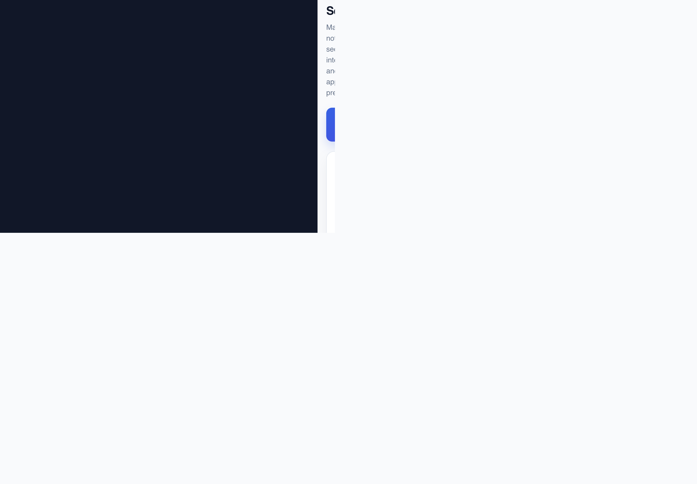

# CortexOS — Enterprise Data Operations Platform



CortexOS is a full-stack data operations portfolio platform built with React, Node.js, Express, and PostgreSQL. It demonstrates authenticated dataset operations, pipeline-status monitoring, data-quality summaries, alert management, per-user settings, role-based administration, and an optional OpenAI-backed Copilot.

[Live demo](https://cortex-enterprise-sigma.vercel.app)

## Screenshots

**Dashboard**



**Dataset Management**



**Pipeline Monitoring**



**Data Quality**



**Alerts Management**



**AI Copilot**



**User Management**


**Settings**



## Implemented Features

- Dataset create, read, update, and delete operations backed by PostgreSQL
- Pipeline status display plus trigger/retry controls
- Data-quality score and validation-metric dashboards
- Alert create, update, resolve, and delete operations
- AI Copilot chat backed by OpenAI, with messages persisted in PostgreSQL and a privacy-limited operational context available on request
- JWT access/refresh authentication with active-user checks and Admin/Editor/Viewer RBAC
- Admin User Management backed by PostgreSQL
- Per-user Settings persistence backed by PostgreSQL/Neon
- Docker Compose setup for PostgreSQL, backend, and frontend

## AI Copilot & Data Privacy

The Copilot works without operational context by default. Set `COPILOT_CONTEXT_ENABLED=true` only when you intentionally want to include a read-only aggregate snapshot in an OpenAI request.

When enabled, the snapshot contains only:

- dataset counts grouped by status
- pipeline counts grouped by status
- alert counts grouped by status and severity
- data-quality counts grouped by status
- average and minimum data-quality scores

It excludes dataset names and owners, pipeline names/sources/destinations, alert titles/messages, chat history, and individual database rows. SQL statements are fixed aggregate `SELECT` queries; neither prompts nor model output can generate SQL.

## Local setup with Docker

Requirements: Docker with Compose support.

```bash
export POSTGRES_PASSWORD='choose-a-local-password'
export JWT_SECRET='choose-a-long-random-access-token-secret'
export JWT_REFRESH_SECRET='choose-a-different-long-random-refresh-secret'
export OPENAI_API_KEY='your-key' # optional; required only for Copilot responses
docker compose up --build
```

Open the frontend at http://localhost:3000 and backend at http://localhost:5050.

Operational context remains disabled unless you explicitly set:

```bash
export COPILOT_CONTEXT_ENABLED=true
```

Do not commit real passwords or API keys. To stop the stack, run `docker compose down`. Add `-v` only when you intentionally want to delete the local PostgreSQL volume.


## Production deployment and initial Admin

Configure the backend with a PostgreSQL `DATABASE_URL`, distinct strong `JWT_SECRET` and `JWT_REFRESH_SECRET`, and a comma-separated `CORS_ORIGINS` list containing the exact frontend origins (for example `https://cortex-enterprise-sigma.vercel.app`). Set `DB_SSL` as required by your database provider. Never commit these values.

Run `npm run migrate` from `backend/` against the intended database to create authentication and per-user Settings tables. This migration can be repeated without dropping existing data. Other core/demo table setup commands remain separate.

The first Admin must be provisioned **once** by a trusted operator in a secure environment with database access:

```bash
cd backend
npm ci
# Set DATABASE_URL, INITIAL_USER_EMAIL and INITIAL_USER_PASSWORD
# privately in your environment. Password must be at least 12 characters.
npm run create:initial-user
```

The command refuses to overwrite an existing email. Remove `INITIAL_USER_PASSWORD` from the environment immediately afterward. Do not expose credentials in tickets, screenshots, logs, or chat. A running backend or a successful build alone does not prove that initial Admin provisioning or end-to-end login succeeded.

For local Docker Compose, configure `POSTGRES_PASSWORD`, `JWT_SECRET` and `JWT_REFRESH_SECRET` before `docker compose up --build`. The initialization job also creates authentication and Settings tables, but it does **not** create an Admin user automatically.

## Development commands

Backend:

```bash
cd backend
npm ci
npm test
npm start
```

Frontend:

```bash
cd frontend
npm ci
npm run lint
npm run build
```

## Scope & Limitations

- Pipeline trigger and retry routes only update the stored status to `Running`. They do not execute a pipeline, job, worker, or orchestration engine.
- Displayed pipeline logs are generated from stored pipeline fields; they are not persisted execution logs.
- Operational context is aggregate-only and disabled by default.
- The public deployment requires correctly configured database, JWT, CORS, and optional OpenAI environment variables; repository code alone does not prove a live environment is configured.
- AI Copilot requires a separately funded/configured OpenAI API key; without one the API returns a configuration error.
